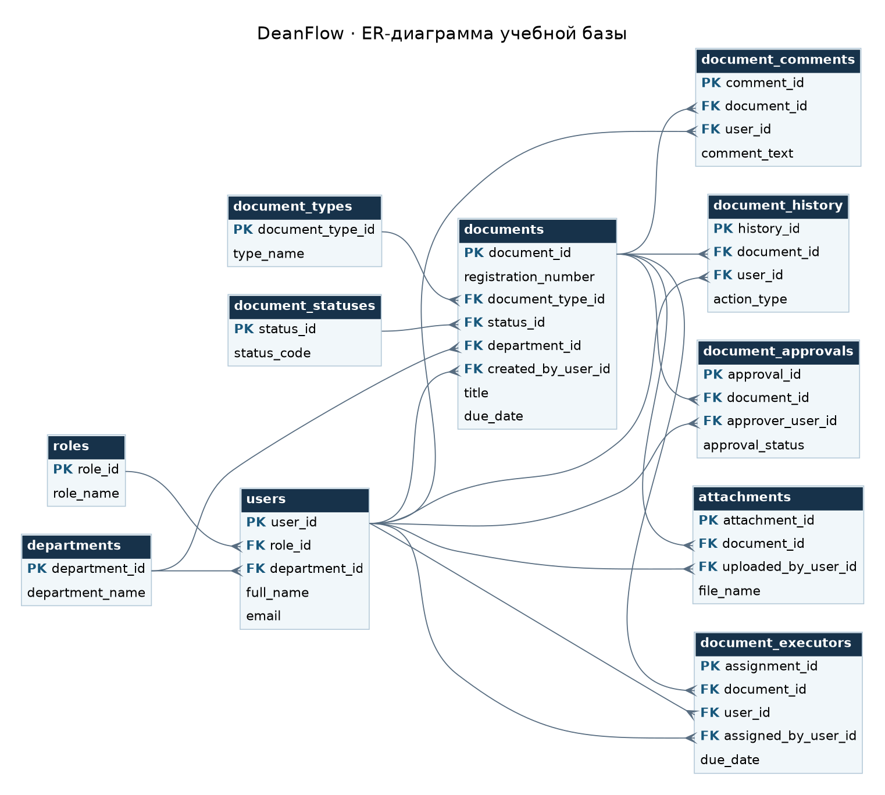

# Информационная система «Деканат» · DeanFlow

**Курс:** Прикладное программное обеспечение информационных систем (2026 г.)
**Автор:** Касанова Аружан, группа ИС-24А

## 1. Предметная область

DeanFlow помогает сотрудникам университетского деканата вести документооборот. Учебное приложение ведёт реестр заявлений, служебных записок и проектов приказов с регистрационными номерами, статусами, приоритетами и сроками. В реестре можно найти документ, отфильтровать список по статусу и направлению, зарегистрировать новую запись, изменить её через API и удалить. В профиле лабораторной № 8 документы доступны после входа, а удаление разрешено администратору.

## Лабораторные работы

| № | Тема | Материалы для защиты |
| --- | --- | --- |
| 1 | Проектирование ИС, Git и Python-окружение | [Отчёт, ER-диаграмма и контрольные вопросы](labs/01/) |
| 2 | SQLModel, связи и заполнение SQLite | [Отчёт и проверка базы](labs/02/) |
| 3 | FastAPI, GET и POST, Swagger | [Отчёт и примеры запросов](labs/03/) |
| 4 | PATCH, DELETE, поиск и фильтры | [Отчёт и сценарий CRUD](labs/04/) |
| 5 | Интерфейс Streamlit | [Сценарий демонстрации](labs/05/) |
| 6 | Docker и Docker Compose | [Развёртывание и проверка тома](labs/06/) |
| 7 | pytest и защита проекта | [Тесты, ревью и порядок показа](labs/07/) |
| 8 | Интеграция, нагрузка, безопасность и CI | [Отчёт и результаты](labs/08/) |

## 2. Архитектура данных



[Масштабируемая версия диаграммы](docs/diagrams/deanflow-er.svg)

- `roles` и `departments` связаны с пользователями `users` по схеме «один ко многим».
- `users`, `document_types`, `document_statuses` и `departments` связаны с документами `documents` по схеме «один ко многим».
- С документом связаны назначения исполнителей, согласования, записи истории, комментарии и метаданные вложений. Для одного документа допускается несколько записей каждого вида.
- ЛР № 8 добавляет таблицу паролей `user_credentials` с хешами и таблицу сессий `login_sessions` с хешами токенов и сроками действия.

## 3. Технологический стек

| Часть | Технологии |
| --- | --- |
| Backend | Python 3.11+, FastAPI, Uvicorn, Pydantic |
| База данных | SQLite, SQLModel, SQLAlchemy |
| Интерфейс | Streamlit, Requests, pandas |
| Запуск | Docker и Docker Compose |
| Проверка | pytest, FastAPI TestClient, Locust, Bandit, GitHub Actions |
| Подготовка и ревью | OpenAI Codex |

Основные точки входа: [сервер](app/main.py), [ORM](app/database/models.py), [начальные данные](app/database/seed.py), [маршруты](app/routers/documents.py), [интерфейс](app/frontend/ui.py), [тесты](tests/). [Изначальная версия DeanFlow на ASP.NET Core MVC и SQL Server](original/) использует отдельную базу.

## 4. Локальное развёртывание

Установите Docker Desktop или Docker Engine с Compose. Клонируйте репозиторий и запустите два сервиса.

```bash
git clone https://github.com/kasanovaaruzan74-oss/-.git deanflow
cd deanflow
docker compose up --build
```

- [Интерфейс Streamlit](http://localhost:8501)
- [Swagger UI](http://localhost:8000/docs)
- [Проверка состояния API](http://localhost:8000/health)

При запуске в базе появляются демонстрационные документы. Порты Docker публикуются на loopback. SQLite хранится в именованном томе `deanflow-demo-data`, который сохраняется после `docker compose down`.

Для ЛР № 8 используйте тот же Compose с переменными `AUTH_REQUIRED=true` и `DEANFLOW_ADMIN_PASSWORD`. Передайте пароль администратора через локальное окружение или игнорируемый Git файл `.env`. Адрес учётной записи по умолчанию `dana@example.invalid`. Подробный запуск и вход описаны в [ЛР № 8](labs/08/).

<details>
<summary>Запуск без Docker</summary>

```bash
python -m venv .venv
```

Активируйте окружение командой `source .venv/bin/activate` в Bash или `.\.venv\Scripts\Activate.ps1` в PowerShell.

```bash
python -m pip install -r requirements.txt
python -m app.database.seed
python -m uvicorn app.main:app --reload
```

В отдельном терминале активируйте окружение и выполните:

```bash
python -m streamlit run app/frontend/ui.py
```

</details>

## 5. Запуск тестов

В активированном виртуальном окружении после установки зависимостей:

```bash
python -m pytest -q
```

Тесты создают временные базы SQLite и проверяют маршруты, валидацию, права доступа и откат транзакций. Для быстрого показа на защите откройте [сценарий ЛР № 7](labs/07/) и [отчёт ЛР № 8](labs/08/).
