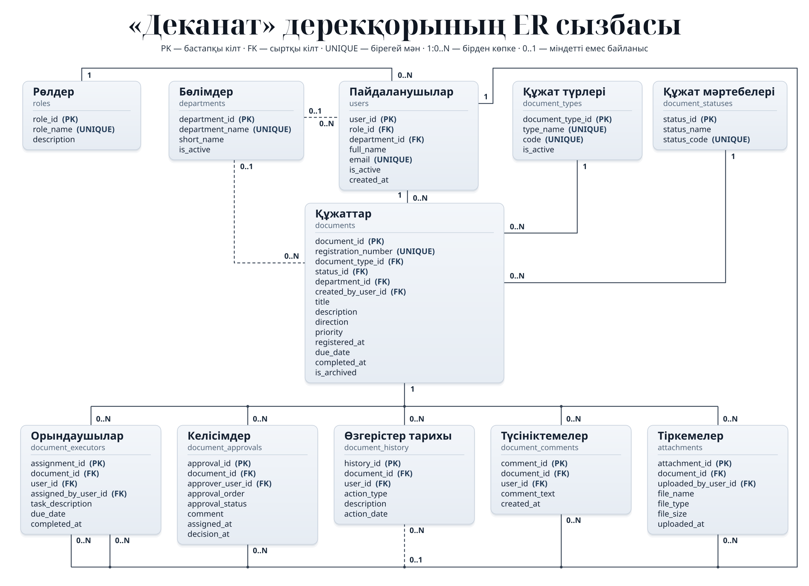

# № 1 зертханалық жұмыс. Ақпараттық жүйені жобалау және Git баптау

[Жобаға оралу](../../README.md) · [№ 2 зертханалық жұмыс](../02/README.md)

**Касанова Аружан · ИС-24А**

## Мақсаты

«Деканат» ақпараттық жүйесін жобалау, Python ортасын дайындау және бастапқы кодты Git арқылы басқаруды баптау.

## Пәндік сала

DeanFlow деканат қызметкерлеріне кіріс, шығыс және ішкі құжаттарды тіркеуге, оларды тізілімнен табуға және орындалу мерзімін бақылауға көмектеседі. Негізгі жүйеде қызметкерлер құжатқа орындаушы тағайындай алады, оны келісуге жібере алады, түсініктеме қалдырып, файл тіркей алады. Зертханалық нұсқада оқу деректерімен құжатты тіркеу, іздеу, жаңарту және жою көрсетіледі.

## ER диаграммасы



[Өңдеуге болатын SVG диаграммасы](../../docs/diagrams/deanflow-er.svg)

| Мән | Мақсаты және байланыстары |
| --- | --- |
| `documents` | Тіркеу нөмірі, тақырыбы, бағыты, басымдығы және мерзімі көрсетілген құжат карточкалары. Әр карточканың түрі, мәртебесі және авторы болады. Бөлімді көрсету міндетті емес. |
| `users` және `roles` | Қызметкерлер және олардың рөлдері. Бір пайдаланушы бірнеше құжат тіркей алады. Бір рөл бірнеше пайдаланушыға беріле алады. |
| `departments` | Бөлімдер. Бір бөлімге бірнеше қызметкер мен құжат тиесілі болуы мүмкін. |
| `document_types` және `document_statuses` | Құжат түрлері мен мәртебелерінің анықтамалықтары. Бір түр немесе мәртебе бірнеше құжатқа қатысты болуы мүмкін. |
| `document_executors` | Орындаушы тағайындаулары. Бір құжатқа бірнеше орындаушы тағайындала алады, ал бір қызметкер бірнеше құжатпен жұмыс істей алады. |
| `document_approvals`, `document_history`, `document_comments`, `attachments` | Келісулер, өзгерістер тарихы, түсініктемелер және тіркемелердің метадеректері. Бір құжатта әр түрден бірнеше жазба болуы мүмкін. |

Қорғау кезінде `departments` → `documents` → `document_executors` → `users` байланысын диаграммадан көрсетіп, сыртқы кілттердің қай өрістерде орналасқанын түсіндіріңіз.

## Ортаны дайындау

Зертханалық жұмыс үшін Python 3.11 немесе одан кейінгі нұсқа қажет. Репозиторийді клондап, жоба бумасын Cursor немесе VS Code бағдарламасында ашыңыз.

```bash
git clone https://github.com/kasanovaaruzan74-oss/-.git deanflow
cd deanflow
```

### Windows PowerShell

```powershell
py -3.11 -m venv .venv
.\.venv\Scripts\Activate.ps1
python -m pip install -r requirements.txt
```

### Linux және macOS

```bash
python3 -m venv .venv
source .venv/bin/activate
python -m pip install -r requirements.txt
```

### Орта мен Git баптауларын тексеру

```bash
python --version
python -m pip check
git remote -v
git status --short
git check-ignore -v -- .venv/ deanflow_labs.db .env
```

| Жол | Жобадағы қызметі |
| --- | --- |
| [`app/database/`](../../app/database/) | Кесте модельдері, SQLite-қа қосылу және бастапқы деректер. |
| [`app/routers/`](../../app/routers/) | Құжаттармен жұмыс істеуге арналған REST маршруттары. |
| [`app/frontend/`](../../app/frontend/) | Streamlit пайдаланушы интерфейсі. |
| [`app/main.py`](../../app/main.py) | FastAPI қолданбасын құру және маршруттарды тіркеу. |
| [`requirements.txt`](../../requirements.txt) | FastAPI, Uvicorn, SQLModel, Streamlit және басқа Python тәуелділіктері. |
| [`.gitignore`](../../.gitignore) | Виртуалды ортаны, кэшті, жергілікті дерекқорды және баптау файлдарын Git-тен шығару ережелері. |

### Жобалау кезінде ЖИ көмекшісіне берілетін сұрау үлгісі

> «Деканат» ақпараттық жүйесі үшін FastAPI, SQLModel және Streamlit қолданылатын жоба құрылымын ұсын. Құжат карточкасы, пайдаланушы, бөлім және анықтамалықтар сызбасы бойынша бастапқы және сыртқы кілттерді сипатта. Ұсынған атаулар мен байланыстарды DeanFlow бастапқы кодымен салыстырып тексер.

## Бақылау сұрақтары

1. **Виртуалды орта не үшін қажет?** Ол кітапханалардың нұсқаларын нақты жобаға бекітеді. Тәуелділіктер ортақ Python ортасына орнатылса, әр жобаның кітапхана нұсқалары бір-бірімен үйлеспеуі мүмкін.
2. **`.gitignore` не істейді?** Онда көрсетілген, Git әлі бақылауға алмаған файлдар әдеттегі `git add` кезінде қосылмайды. Виртуалды ортаны `requirements.txt` арқылы қайта құруға болады, ал құпиясөздері бар баптаулар репозиторийден тыс сақталады. Git бақылап тұрған файлды `.gitignore` ережесі тарихтан өшірмейді.
3. **Cursor немесе басқа ЖИ көмекшісі қалай көмектеседі?** Жобаның бастапқы құрылымын дайындауды тездетіп, өзгерістерді түсіндіреді. Ұсынылған кодты жүйе сызбасымен, кітапхана құжаттамасымен және іске қосу нәтижесімен салыстырып тексеру қажет.
4. **Тармақ не үшін керек?** Тармақ — соңғы коммитке сілтейтін және жаңа коммит жасалған сайын жаңаратын сілтеме. Ол жаңа функцияны бөлек әзірлеуге мүмкіндік береді. Топтық жұмыста `main` қорғалады, сондықтан өзгерістер код тексеріліп, автоматты сынақтар өткен соң енгізіледі.
5. **`git commit` пен `git push` қандай қызмет атқарады?** `git commit` дайындалған өзгерістерді жергілікті репозиторий тарихына жазады. `git push` жергілікті коммиттерді қашықтағы серверге жіберіп, сол жақтағы тармақ сілтемесін жаңартады.
