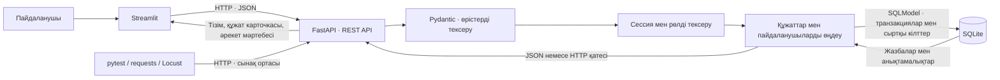
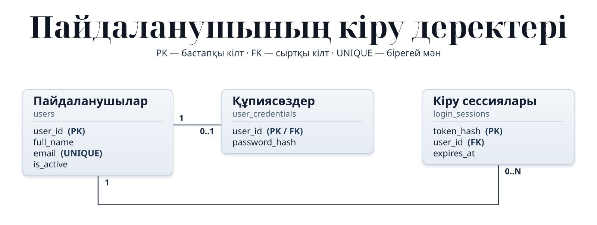
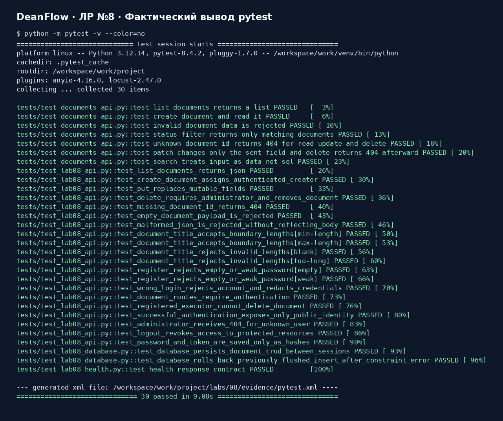

# №8 зертханалық жұмыс

**«Деканат» ақпараттық жүйесін кешенді интеграциялық, жүктемелік және қауіпсіздік тұрғысынан тестілеу**

## 1. Титулдық бет

| | |
|---|---|
| Пән | Ақпараттық жүйелердің қолданбалы бағдарламалық жасақтамасы |
| Орындаған | Касанова Аружан |
| Топ | ИС-24А |
| Жыл | 2026 |

## 2. Мақсат

DeanFlow жобасының интерфейсі, REST API, авторизация модулі және дерекқоры бірге қалай жұмыс істейтінін тексеру. Әртүрлі жүктемедегі жауап уақытын өлшеу, қол жеткізу ережелерін тексеру және код өзгерген сайын автоматты тексерістерді іске қосу. Бұл жұмыс сол жобаның №7 зертханалық жұмысын жалғастырады. [№7 зертханалық жұмыс](../07/README.md)

## 3. Архитектура



| Компонент | Деректер алмасу жолы | Ықтимал ақаулар | Интеграциялық тексеріс |
|---|---|---|---|
| Streamlit интерфейсі | Форма өрістерінен JSON құрастырады, тізімді `GET` арқылы жүктейді | Сервер қолжетімсіз, форма деректері тексерістен өтпейді | Интерфейс → API, API қатесі → интерфейстегі хабарлама |
| FastAPI сервері | Өңдегішті таңдайды, дерекқор сессиясын ашады және HTTP жауабын қайтарады | Сұраудың күту уақыты бітеді, жазу кезінде қате шығады | Uvicorn → FastAPI → өңдегіш |
| SQLite дерекқоры | Құжаттарды, анықтамалықтарды, есептік жазбалар мен сессияларды сақтайды | `UNIQUE` шектеуі бұзылады, сыртқы кілт жарамсыз | API → SQLite, транзакцияны кері қайтаруды жеке тексеру |
| Аутентификация | Құпиясөзді хеш бойынша тексереді және қолданылу мерзімі шектеулі Bearer токенін береді | Құпиясөз қате, сессияның мерзімі өткен | `/auth/login` → токен → қорғалған маршрут |
| REST API | GET, POST, PUT, DELETE әдістерін қабылдайды, JSON немесе денесі бос 204 жауабын қайтарады | JSON форматы қате, көрсетілген идентификатор табылмайды | CRUD реті және қате енгізу сценарийлері |
| Қауіпсіздік | Рөлді тексереді, қысқа хабарлама қайтарады және токеннің хешін сақтайды | Орындаушы құжатты жоюға тырысады, құпиясөз қате хабарламасына немесе журналға түседі | Құпиясөзді тексеру, рөлдер бойынша қол жеткізуді шектеу, қате жауабындағы құпия деректерді жасыру |

Рөл, есептік жазба, құпиясөз хеші және кіру сессиясы арасындағы байланыстар ER диаграммада көрсетілген. [SVG нұсқасы](../../docs/diagrams/deanflow-auth-er.svg)



## 4. Құралдар

| Құрал | Қолданылуы |
|---|---|
| Python, FastAPI, Uvicorn | Сынақ ортасын іске қосу және HTTP сұрауларын өңдеу |
| Streamlit | Құжаттарды қарау және тіркеу интерфейсі |
| SQLModel, SQLite | Деректерді сақтау және транзакцияларды тексеру |
| pytest, requests | Автоматты тексерістер және REST API-дің нақты жауаптарын тіркеу |
| Locust, psutil, Matplotlib | Жүктеме сценарийлері, процесс ресурстарын өлшеу және графиктер |
| Bandit, GitHub Actions | Статикалық талдау және код жаңарғанда тексерістерді іске қосу |

## 5. REST API-ді интеграциялық тестілеу

Сынақтар жасанды деректер толтырылған уақытша SQLite дерекқорында орындалды. Тексеру барысында жасалған өзгерістер уақытша дерекқормен бірге жойылады. `PUT` өңдеуге болатын өрістердің толық жиынын алмастырады, ал `PATCH` жекелеген өрістерді жаңартады.

| Сценарий | Маршрут | Код | Жауап мазмұны |
|---|---|---:|---|
| Құжаттар тізімін оқу | `GET /documents` | 200 | Құжат карточкаларының массиві |
| Құжатты тіркеу | `POST /documents` | 201 | Жаңа карточка, идентификатор және тіркеу нөмірі |
| Құжатты жаңарту | `PUT /documents/{id}` | 200 | Өрістері алмастырылған карточка |
| Құжатты әкімші ретінде жою | `DELETE /documents/{id}` | 204 | Жауап денесі бос |
| Құжаттың жойылғанын тексеру | `GET /documents/{id}` | 404 | Құжат табылмағаны туралы хабарлама |
| Бос объект жіберу | `POST /documents` | 400 | Деректерді тексеру туралы жалпы қате |
| Синтаксисі қате JSON жіберу | `POST /documents` | 400 | Деректерді тексеру туралы жалпы қате |
| Жоқ пайдаланушыны іздеу | Әкімші рөлімен `GET /auth/users/{id}` | 404 | Пайдаланушы табылмағаны туралы хабарлама |
| Жүйеге кірмей қорғалған тізімді сұрау | `GET /documents` | 401 | Жүйеге кіру қажет, `WWW-Authenticate: Bearer` |

Нақты HTTP тексерісіндегі 16 сценарийдің бәрі күтілген мәртебе кодын қайтарды. Хаттамада жауаптың коды, денесі және түрі сақталған. [HTTP жауаптарының хаттамасы](evidence/api.json)

## 6. Дерекқорды тестілеу

Тесттер SQLModel арқылы уақытша SQLite файлын ашып, `INSERT`, `SELECT`, `UPDATE` және `DELETE` операцияларын орындайды. Өзгерістер арасындағы қайта оқу әрекеттері нәтижелердің сақталғанын тексереді. Бөлек транзакцияда алғашқы жазба сәтті енгізілгеннен кейін `UNIQUE` шектеуі бар өріске дәл сол мәнмен екінші жазба қосылды. SQLAlchemy `IntegrityError` қатесін қайтарды. `rollback()` орындалған соң жаңа сессия аралық жазбаның сақталмағанын және бұрынғы деректердің қолжетімді екенін растады. Бұл екінші операция сәтсіз аяқталғанда транзакцияның атомарлығы мен дерек тұтастығы сақталатынын көрсетті. SQLite бойынша екі тест те өтті. [Дерекқор тесттері](../../tests/test_lab08_database.py)

## 7. Жүктемелік тестілеу

Locust 2.47.0 бастапқы SQLite қосылымдар пулы бар жергілікті `AUTH_REQUIRED=true` режимінде төрт сценарийді кезекпен іске қосты. Сценарий тізілімді қарауды, `REGISTERED` мәртебесі бойынша сүзуді және анықтамалықтарды жүктеуді имитациялады. Осы үш GET сұрауы 5:3:2 арақатынасымен қолданылды. Әр виртуалды пайдаланушы сұраулар арасында 0,3–0,7 секунд кідірді. Жүктеме басталғанға дейін кездейсоқ сынақ есептік жазбасы және Bearer токені жасалды.

Сынақ ортасында Python 3.12.14, бір Uvicorn процесі және төрт жасанды құжаты бар уақытша SQLite дерекқоры пайдаланылды. Қорғалған режимдегі процестер базалық сынақтан бөлек екі логикалық ядроға бекітілді. `psutil` API процесінің CPU мен RSS көрсеткіштерін шамамен секунд сайын өлшеді. 100% CPU бір логикалық ядроның толық жүктелуін білдіреді. p50 және p95 сұраулардың тиісінше 50%-ы мен 95%-ы қанша уақытта аяқталғанын көрсетеді.

| Пайдаланушылар | Уақыт, с | Сұраулар | Қате саны / % | Орташа / p50 / p95, мс | Сұрау/с | CPU орташа / ең жоғары, % | RAM орташа / ең жоғары, МиБ |
|---:|---:|---:|---:|---:|---:|---:|---:|
| 5 | 60 | 590 | 0 / 0,00 | 4,8 / 4,0 / 10,0 | 10,0 | 3,2 / 7,0 | 61,9 / 62,1 |
| 20 | 120 | 4 537 | 0 / 0,00 | 19,4 / 4,0 / 38,0 | 37,9 | 12,3 / 27,0 | 66,8 / 69,3 |
| 50 | 180 | 17 470 | 0 / 0,00 | 12,2 / 5,0 / 44,0 | 97,4 | 31,1 / 54,0 | 77,1 / 79,4 |
| 100 | 180 | 3 215 | 3200 / 99,53 | 4 980,7 / 5 000,0 / 5 000,0 | 18,1 | 2,4 / 27,0 | 131,4 / 179,3 |


Пайдаланушылар саны 50-ден 100-ге артқанда p95 44,0 мс-тан 5 000,0 мс-қа өсті, ал секундтағы сұрау саны 97,4-тен 18,1-ге төмендеді. Қателер саны 0-ден 3 200-ге өсті. CPU жүктемесі бір ядроның орта есеппен 2,4%-ын құрады, ал RSS 77,1 МиБ-тан 131,4 МиБ-қа өсті. Клиенттер жауапты шамамен 5 секунд күтті. Uvicorn журналы SQLAlchemy пулындағы 5 негізгі және 10 қосымша қосылымның бәрі бос емес екенін тіркеді. [Пул қатесі](evidence/sqlite-pool-error.txt) · [Locust тайм-ауттары](evidence/load-protected/users-100_failures.csv)

Файлдық SQLite үшін `NullPool` таңдалды. Қосылым сессия аясында пайдаланылады және сессия аяқталғанда жабылады. Сыртқы кілттерді тексеру әр қосылым ашылғанда қосылады. Осылайша бастапқы пулдың шектеуі жойылды. Жедел жадтағы SQLite үшін SQLAlchemy-дің әдепкі параметрлері қолданылады. [Дерекқорға қосылу параметрлері](../../app/database/db.py)

| Қайта сынау, 100 пайдаланушы, 180 с | Сұраулар | Қате саны / % | p95, мс | Сұрау/с | CPU орташа / ең жоғары, % | RAM орташа / ең жоғары, МиБ |
|---|---:|---:|---:|---:|---:|---:|---:|
| Түзетуге дейін | 3 215 | 3 200 / 99,53 | 5 000,0 | 18,1 | 2,4 / 27,0 | 131,4 / 179,3 |
| `NullPool` қосылғаннан кейін | 34 894 | 0 / 0,00 | 38,0 | 194,7 | 62,0 / 78,9 | 92,3 / 96,9 |

Өнімділікті тереңірек бағалау үшін құжаттар санын көбейтіп, қатар орындалатын жазу операцияларын бөлек сынау қажет. Одан кейін жиі қолданылатын сүзгілерге беттеу мен индекстердің әсерін өлшеуге болады. [Қайталау сынағының нәтижесі](evidence/load-fixed/summary.json)

Салыстыру үшін `2153fe0637ca` ревизиясындағы бастапқы оқу API-інде авторизациясыз төрт сценарий бөлек орындалды. API 25 709 сұрауды өңдеді және 3200 қатені тіркеді. Жұмыс режимі мен CPU ядроларына бекіту тәсілі өзгеше болғандықтан, бұл серия анықтамалық көрсеткіш ретінде берілген. [Бастапқы ревизия](https://github.com/kasanovaaruzan74-oss/--DeanFlow/commit/2153fe0637cad95815d97bb04e648a32b2c6ac66) · [Базалық сынақтың жиынтық нәтижесі](evidence/load-baseline/summary.json)

Сынақты қайталау үшін виртуалды ортаны белсендіріп, жоба түбірінен мына командаларды орындаңыз.

```bash
python -m pip install -r requirements.txt -r load/requirements.txt
python load/run_load.py --authenticated --output build/load-results
python load/run_load.py --authenticated --users 100 --output build/load-retest
python load/plot_load.py build/load-results/summary.json build/load-results/locust.png
```

Есепте бағдарламалық жасақтама нұсқалары мен өлшеу кезінде қолданылған код файлдарының хештері сақталған. CSV файлдарында HTTP маршруттары бойынша қорытынды және процесс ресурстарының өлшемдері берілген. [Жиынтық есеп](evidence/load-protected/summary.json) · [Сценарийлердің CSV файлдары](evidence/load-protected/) · [Locust сценарийі](../../load/locustfile.py)

## 8. Қауіпсіздікті тексеру

| Тексеріс | Нәтиже |
|---|---|
| Бос құпиясөзбен тіркелу | 400, есептік жазба жасалмады |
| Тым қысқа немесе құрамында цифр жоқ құпиясөз | 400, есептік жазба жасалмады |
| Белгісіз логинмен немесе қате құпиясөзбен кіру | 401, екі жағдайда да есептік жазбаның бар-жоғын ашпайтын бірдей хабарлама |
| Қорғалған құжатты токенсіз оқу | 401, деректер қолжетімсіз |
| JSON ішіндегі деректердің түрі жарамсыз | 400, хабарламада жіберілген мән көрсетілмейді |
| Орындаушының құжатты жоюы | 403, операцияны әкімші орындай алады |
| Орындаушы токенімен басқа адамның профилін сұрау | 403 |
| Жүйеден шыққаннан кейін қайта сұрау жіберу | 401, сессия жойылған |
| Жарамсыз деректер жіберілгенде жауап пен журналды тексеру | Құпиясөздер мен токендер тіркелмеген |

Құпиясөз әр есептік жазбаға жеке тұз қолданылатын PBKDF2-HMAC-SHA256 хеші түрінде сақталады. Сервер қолданылу мерзімі шектеулі кездейсоқ токеннің SHA-256 хешін сақтайды. Bandit 1.9.4 қолданба кодының 991 жолын талдап, 0 ескерту қайтарды. [Bandit есебі](evidence/bandit.json) · [Сынақ кезіндегі Uvicorn журналы](evidence/server-access.txt)

## 9. Автоматты тесттер

```bash
python -m pip install -r requirements.txt
python -m pytest -v
```

Жергілікті ортада 30 тест, соның ішінде №8 зертханалық жұмыстың 23 тесті өтті. Тесттер қалыпты операцияларды, құжат атауының 3 және 250 таңбалық шекараларын, жарамсыз деректерді, рөл шектеулерін және транзакцияны кері қайтаруды қамтиды. [Тест коды](../../tests/) · [Мәтіндік хаттама](evidence/pytest.txt) · [JUnit XML](evidence/pytest.xml)



## 10. GitHub Actions

Жұмыс үдерісі `push` және `pull_request` кезінде іске қосылады, pytest пен Bandit тексерістерін орындайды және JUnit есебін сақтайды. Бақылау тәжірибесі `lab08-ci-check` тармағында жүргізілді. Тест `GET /health` жауабын жарияланған келісімшарттағы нақты мәнмен салыстырады.

| Іске қосу | Нәтиже | Дәлел |
|---|---|---|
| Негізгі тармақ, `8a95703` | 30 тест пен Bandit тексерісі өтті | [GitHub Actions](https://github.com/kasanovaaruzan74-oss/-/actions/runs/45582972861) · [Скриншот](evidence/ci-main.png) |
| Жауап мәтінін әдейі ауыстыру, `c390187` | `test_health_response_contract` сәйкессіздікті тапты. 1 тест сәтсіз аяқталды, 29 тест өтті | [GitHub Actions](https://github.com/kasanovaaruzan74-oss/-/actions/runs/45583080543) · [Скриншот](evidence/ci-failed.png) · [Журнал үзіндісі](evidence/ci-failed-pytest.txt) |
| Келісімшартты қалпына келтіру, `5e56270` | 30 тест пен Bandit тексерісі қайтадан өтті | [GitHub Actions](https://github.com/kasanovaaruzan74-oss/-/actions/runs/45583419404) · [Скриншот](evidence/ci-restored.png) |

[CI баптауы](ci.md) · [Жергілікті ортада қайталау хаттамасы](evidence/red-green-local.txt)

## 11. Анықталған кемшіліктер және түзетулер

| Байқалған жағдай | Түзету | Қайта тексеру |
|---|---|---|
| Бастапқы оқу нұсқасында жүйеге кірмей-ақ құжаттармен жұмыс істеуге болатын | `AUTH_REQUIRED=true` режимінде сұраулардың жарамды токені мен рөл құқығы тексеріледі | Токенсіз 401, орындаушы құжатты жоюға әрекеттенгенде 403 |
| Бастапқы API өрістерді `PATCH` арқылы ішінара жаңартуды қолдады | Өңдеуге болатын өрістерді толық алмастыратын `PUT` қосылды | Жаңарту 200 кодын, кейінгі оқу жаңа мәндерді қайтарды |
| Валидацияның егжей-тегжейлі жауаптарында жіберілген мән көрінуі мүмкін еді | №8 жұмыс режимінде өңдегіш өріс мазмұнынсыз қате хабарламасын қайтарады | Жарамсыз JSON мен қате дерек түрі 400 кодын береді, жауап пен журналда құпия деректер жоқ |
| 100 пайдаланушы бірден қосылғанда SQLite қосылымдар пулы толып қалды | Файлдық SQLite қосылымдарды `NullPool` арқылы ашады | Қайталау кезінде 34 894 сұрау, 0 қате, p95 38 мс |

## 12. Қорытынды

Жұмыс HTTP сұрауларын, SQL транзакцияларын, қол жеткізу құқықтарын және өнімділікті бір сынақ ортасында тексерді. Автоматты тексерістер кодтағы регрессияны өзгеріс негізгі нұсқаға түспей тұрып анықтауға мүмкіндік береді. Файлдық SQLite `NullPool` режиміне ауыстырылғаннан кейін 100 виртуалды пайдаланушымен үш минуттық қайта тексеруде 34 894 сұрау қатесіз өңделді. p95 38 мс болды. Барлық 30 автоматты тест қайтадан өтті. Бұл нәтижелер бір Uvicorn процесі бар жергілікті ортада жасанды құжаттар тізілімін оқуға қатысты.

## Қорғалған режимді іске қосу

Docker арқылы іске қосу үшін параметрлерді `docker-compose.yml` жанындағы жергілікті `.env` файлына жазыңыз. Толтырғыштың орнына әріптер мен цифрлардан құралған, кемінде 12 таңбасы бар құпиясөзді енгізіңіз. `.env` файлы Git-ке қосылмайды.

```dotenv
AUTH_REQUIRED=true
DEANFLOW_ADMIN_EMAIL=dana@example.invalid
DEANFLOW_ADMIN_PASSWORD=<құпиясөзіңіз>
```

```bash
docker compose up --build -d
```

Docker қолданбасаңыз, виртуалды ортаны белсендіріп, тәуелділіктерді орнатыңыз. Содан кейін Bash терминалында сұралған құпиясөзді енгізіп, API-ді іске қосыңыз.

```bash
export AUTH_REQUIRED=true
export DEANFLOW_ADMIN_EMAIL=dana@example.invalid
read -rsp 'Әкімші құпиясөзі: ' DEANFLOW_ADMIN_PASSWORD
printf '\n'
export DEANFLOW_ADMIN_PASSWORD
python -m app.database.seed
python -m uvicorn app.main:app
```

Басқа терминалда `python -m streamlit run app/frontend/ui.py` командасын орындаңыз. Интерфейске `dana@example.invalid` мекенжайы мен өзіңіз орнатқан құпиясөз арқылы кіріңіз. [Streamlit интерфейсі](http://localhost:8501)

Swagger UI ішінде алдымен `POST /auth/register` арқылы орындаушыны тіркеңіз, содан кейін `POST /auth/login` шақырып, алынған `access_token` мәнін **Authorize** батырмасы арқылы енгізіңіз. Қорғау кезінде `GET /documents` сұрауын токенсіз және токенмен жіберіп, нәтижелерін салыстырыңыз. Содан кейін орындаушының `DELETE` әдісіне рұқсаты жоқ екенін көрсетіңіз. [Swagger UI](http://localhost:8000/docs)

## Қорғауға арналған қысқа жауаптар

1. **Интеграциялық тесттің мақсаты қандай?** Компоненттердің деректерді дұрыс алмасатынын және бірге жұмыс істегенде туындайтын қателерді өңдейтінін растау.
2. **Unit және Integration тесттерінің айырмасы қандай?** Unit-тест бір функцияны немесе ережені тексереді. Интеграциялық тест бірнеше компоненттің, мысалы API мен SQLite-тің, бірге жұмысын тексереді.
3. **HTTP кодтары нені білдіреді?** `200` сұрау сәтті орындалды, `201` ресурс жасалды, `204` операция сәтті орындалды және жауап денесі бос, `400` сұрау жарамсыз, `401` жүйеге кіру қажет, `403` әрекетке рұқсат жоқ, `404` ресурс табылмады.
4. **Жүктемелік тексерістің қандай түрлері бар?** Қалыпты жүктемені тексеру, күтілген деңгейден жоғары стресс-тест, жүктеменің кенет артуын тексеру және тұрақтылықты ұзақ сынау.
5. **Response Time және Throughput нені өлшейді?** Response Time жауап уақытын, әдетте миллисекундпен, ал Throughput уақыт бірлігінде өңделген сұраулар санын өлшейді.
6. **SQL транзакциясының тұтастығы қалай сақталады?** Шектеулер деректердің жарамдылығын тексереді. `commit` бүкіл транзакцияны бекітеді, `rollback` оның аралық өзгерістерін кері қайтарады.
7. **Қауіпсіздік тестінің міндеттері қандай?** Қол жеткізуді шектеуді, енгізілген деректерді тексеруді, жауаптар мен журналдардағы құпия деректердің қорғалуын және құпиясөздер мен токендердің хеш түрінде сақталуын тексеру.
8. **pytest не үшін қолданылады?** Тесттерді жинайды, тәуелсіз фикстуралармен сценарийлерді іске қосады және нақты нәтиже күтілген мәнге сәйкес келмегенде қатені түсіндіреді.
9. **CI сапаға қалай әсер етеді?** Әр өзгеріске бірдей автоматты тексерістер жүргізіледі. Іске қосу тарихынан келісімшарттың қай өзгерістен кейін бұзылғанын көруге болады.
10. **Автоматты тестілеудің қандай шектеулері бар?** Тесттер алдын ала сипатталған сценарийлерді қамтиды және келісімшарт өзгерсе, оларды жаңарту қажет. Интерфейсті пайдалану ыңғайлылығы бөлек тексеріледі.
11. **Жүйе жүктемеге төтеп бере алмаса, не істеуге болады?** Баяу сұрауларды, беттеуді және индекстерді тексеру қажет. Қатар орындалатын жазу операциялары көп болса, PostgreSQL мен бірнеше API процесін қарастырған жөн. Әр өзгерістен кейін өлшеуді қайталау керек.
12. **Нәтижелерді құжаттау неге маңызды?** Сынақ ортасының параметрлері, сценарий, нақты көрсеткіштер және код нұсқасы сынақты қайта өткізуге және нәтижелер арасындағы айырманы түсіндіруге мүмкіндік береді.

[№8 зертханалық жұмыстың тапсырмасы](https://chatgpt.com/s/t_6af4005ed7f88191a5fabf3cf1cedc50)
