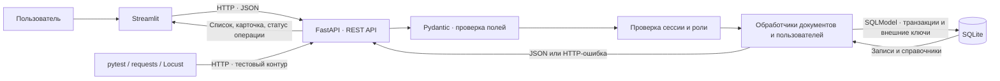
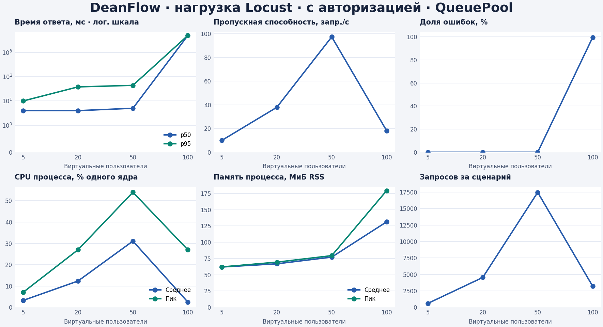

# Лабораторная работа № 8

**Комплексное интеграционное, нагрузочное и безопасностное тестирование информационной системы «Деканат»**

| | |
|---|---|
| Дисциплина | Прикладное программное обеспечение информационных систем |
| Выполнила | Касанова Аружан |
| Группа | ИС-24А |
| Год | 2026 |

## 2. Цель

Проверить совместную работу интерфейса, REST API, авторизации и базы данных проекта DeanFlow. Измерить время ответа при разных уровнях нагрузки, проверить правила доступа и включить автоматические проверки при изменении кода. Работа продолжает [лабораторную № 7](../07/README.md) по тому же проекту.

## 3. Архитектура



| Компонент | Как передаёт данные | Возможные сбои | Интеграционная проверка |
|---|---|---|---|
| Интерфейс Streamlit | Из полей формы формирует JSON, список загружает через `GET` | Сервер недоступен, форма отклонена валидатором | UI → API, ошибка API → сообщение в интерфейсе |
| Сервер FastAPI | Выбирает обработчик, создаёт сессию БД, возвращает HTTP-ответ | Просрочка запроса, исключение при записи | Uvicorn → FastAPI → обработчик |
| База SQLite | Хранит документы, справочники, учётные записи и сессии | Нарушение `UNIQUE`, недопустимый внешний ключ | API → SQLite и отдельная транзакция с откатом |
| Аутентификация | Проверяет пароль по хешу, выдаёт ограниченный по времени Bearer-токен | Неверный пароль, истёкшая сессия | `/auth/login` → токен → защищённый маршрут |
| REST API | Принимает методы GET, POST, PUT и DELETE, возвращает JSON или пустой ответ 204 | Некорректный JSON, отсутствующий идентификатор | Последовательность CRUD, отрицательные случаи |
| Защита | Сверяет роль и выдаёт краткие сообщения, хранит отпечаток токена | Исполнитель пытается удалить документ, пароль попадает в ошибку или журнал | Валидация пароля, граница ролей, маскирование ошибок |

## 4. Инструменты

| Инструмент | Применение |
|---|---|
| Python, FastAPI, Uvicorn | Запуск стенда и обработка HTTP-запросов |
| Streamlit | Интерфейс просмотра и регистрации документов |
| SQLModel, SQLite | Хранение данных и проверка транзакций |
| pytest, requests | Автоматические проверки и фактические ответы REST API |
| Locust, psutil, Matplotlib | Нагрузочные сценарии, измерение ресурсов процесса и графики |
| Bandit, GitHub Actions | Статический анализ и запуск проверок при обновлении кода |

## 5. Интеграционное тестирование REST API

Прогоны выполняются на временной SQLite с синтетическими данными. Изменения, сделанные во время проверки, удаляются вместе с временной базой. `PUT` обновляет полное редактируемое представление, `PATCH` сохраняет поддержку частичного обновления.

| Сценарий | Маршрут | Код | Содержание ответа |
|---|---|---:|---|
| Прочитать список | `GET /documents` | 200 | Массив карточек документов |
| Зарегистрировать документ | `POST /documents` | 201 | Созданная карточка, идентификатор и номер регистрации |
| Обновить документ | `PUT /documents/{id}` | 200 | Карточка с заменёнными полями |
| Удалить документ администратором | `DELETE /documents/{id}` | 204 | Пустое тело |
| Проверить результат удаления | `GET /documents/{id}` | 404 | Сообщение об отсутствии документа |
| Отправить пустой объект | `POST /documents` | 400 | Общая ошибка валидации |
| Отправить синтаксически неверный JSON | `POST /documents` | 400 | Общая ошибка валидации |
| Прочитать отсутствующего пользователя | `GET /auth/users/{id}` с ролью администратора | 404 | Сообщение об отсутствии пользователя |
| Запросить защищённый список без входа | `GET /documents` | 401 | Требуется авторизация, `WWW-Authenticate: Bearer` |

Все 16 сценариев реального HTTP-прогона получили ожидаемые статусы. В протоколе сохранены код, тело и сведения о типе ответа. [api.json](evidence/api.json).

## 6. Тестирование базы данных

Тесты открывают временный файл SQLite через SQLModel и выполняют `INSERT`, `SELECT`, `UPDATE` и `DELETE` с повторным чтением между изменениями. В отдельной транзакции после предварительной успешной вставки добавляется запись с дублирующимся значением поля `UNIQUE`. SQLAlchemy сообщает об `IntegrityError`. После `rollback()` новый сеанс подтверждает, что промежуточная вставка не сохранилась, а существующие записи доступны. Это проверяет атомарность транзакции и сохранение целостности при отказе второй операции. Обе проверки SQLite прошли. [Тесты базы данных](../../tests/test_lab08_database.py).

## 7. Нагрузочное тестирование

Locust 2.47.0 запускал четыре последовательных сценария против локального `AUTH_REQUIRED=true` с исходным пулом соединений SQLite. Сценарий имитировал просмотр реестра, фильтр по статусу `REGISTERED` и загрузку справочников. В пропорции 5:3:2 использовались только запросы GET. Каждый виртуальный пользователь выдерживал паузу от 0,3 до 0,7 секунды. Случайный тестовый аккаунт и Bearer-токен создавались до запуска нагрузки.

Стенд использовал Python 3.12.14, один процесс Uvicorn и временную SQLite с четырьмя синтетическими документами. Процессы защищённого прогона выполнялись на двух логических ядрах с отдельной привязкой от базового прогона. `psutil` измерял CPU и RSS процесса API примерно раз в секунду. 100% CPU соответствует полностью занятому логическому ядру. p50 и p95 указывают, за какое время завершились 50% и 95% запросов.

| Пользователи | Время, с | Запросы | Ошибки, шт. / % | Среднее / p50 / p95, мс | Запросов/с | CPU сред. / пик, % | RAM сред. / пик, МиБ |
|---:|---:|---:|---:|---:|---:|---:|---:|
| 5 | 60 | 590 | 0 / 0,00 | 4,8 / 4,0 / 10,0 | 10,0 | 3,2 / 7,0 | 61,9 / 62,1 |
| 20 | 120 | 4 537 | 0 / 0,00 | 19,4 / 4,0 / 38,0 | 37,9 | 12,3 / 27,0 | 66,8 / 69,3 |
| 50 | 180 | 17 470 | 0 / 0,00 | 12,2 / 5,0 / 44,0 | 97,4 | 31,1 / 54,0 | 77,1 / 79,4 |
| 100 | 180 | 3 215 | 3200 / 99,53 | 4 980,7 / 5 000,0 / 5 000,0 | 18,1 | 2,4 / 27,0 | 131,4 / 179,3 |



При переходе с 50 к 100 пользователям p95 вырос с 44,0 до 5 000,0 мс, а количество запросов в секунду сократилось с 97,4 до 18,1. Ошибки выросли с 0 до 3 200. CPU в среднем использовался на 2,4% одного ядра, а RSS выросла с 77,1 до 131,4 МиБ. Клиентские ожидания длились около 5 секунд, а журнал Uvicorn зафиксировал исчерпание пула SQLAlchemy из 5 основных и 10 дополнительных соединений. [Ошибка пула](evidence/sqlite-pool-error.txt) · [Тайм-ауты Locust](evidence/load-protected/users-100_failures.csv).

Для файловой SQLite выбран `NullPool`. Соединение используется в рамках сессии и закрывается при её завершении. Настройки внешних ключей применяются при каждом открытии. Это снимает ограничение прежнего пула. Для SQLite в памяти применяются обычные настройки SQLAlchemy. [Настройка доступа к БД](../../app/database/db.py).

| Повтор 100 пользователей, 180 с | Запросы | Ошибки, шт. / % | p95, мс | Запросов/с | CPU сред. / пик, % | RAM сред. / пик, МиБ |
|---|---:|---:|---:|---:|---:|---:|
| До исправления | 3 215 | 3 200 / 99,53 | 5 000,0 | 18,1 | 2,4 / 27,0 | 131,4 / 179,3 |
| С `NullPool` | 34 894 | 0 / 0,00 | 38,0 | 194,7 | 62,0 / 78,9 | 92,3 / 96,9 |

Для дальнейшей оценки нужны больший объём документов и отдельный сценарий конкурирующих записей. Затем можно измерить влияние пагинации и индексов на частые фильтры. [Результат повторного прогона](evidence/load-fixed/summary.json).

Для сравнения отдельно выполнены четыре сценария на исходном учебном API ревизии `2153fe0637ca` без авторизации. Он обработал 25 709 запросов и зарегистрировал 3200 ошибок. Режим и привязка CPU отличаются, поэтому эту серию можно использовать как справочный результат. [Исходная ревизия](https://github.com/kasanovaaruzan74-oss/--DeanFlow/commit/2153fe0637cad95815d97bb04e648a32b2c6ac66) · [Сводка базового прогона](evidence/load-baseline/summary.json).

Повторный запуск в активном виртуальном окружении из корня проекта.

```bash
python -m pip install -r requirements.txt -r load/requirements.txt
python load/run_load.py --authenticated --output build/load-results
python load/run_load.py --authenticated --users 100 --output build/load-retest
python load/plot_load.py build/load-results/summary.json build/load-results/locust.png
```

Приложенный отчёт сохраняет версии ПО и хеши файлов измеренного кода. CSV содержат итог по HTTP-маршрутам и отсчёты процесса. [Сводка](evidence/load-protected/summary.json) · [CSV по сценариям](evidence/load-protected/) · [Сценарий Locust](../../load/locustfile.py).

## 8. Проверка безопасности

| Проверка | Результат |
|---|---|
| Регистрация с пустым паролем | 400, запись не создана |
| Слишком короткий пароль или пароль без цифры | 400, запись не создана |
| Вход с неизвестным логином или неправильным паролем | Одинаковое сообщение 401 без подтверждения наличия аккаунта |
| Чтение защищённого документа без токена | 401, данные недоступны |
| Некорректные типы в JSON | 400, введённое значение скрыто в сообщении |
| Удаление документа исполнителем | 403, администратор может выполнить операцию |
| Чужой профиль по токену исполнителя | 403 |
| Повторное обращение после выхода | 401, сессия удалена |
| Ошибки и логи при проверках ввода | Без паролей и токенов |

Пароль хранится в виде PBKDF2-HMAC-SHA256 с индивидуальной солью. Сервер хранит SHA-256 отпечаток случайного токена с ограниченным сроком жизни. Проверка Bandit 1.9.4 обработала 991 строку приложения и вернула 0 замечаний. [Отчёт Bandit](evidence/bandit.json) · [Журнал Uvicorn тестового прогона](evidence/server-access.txt).

## 9. Автоматические тесты

```bash
python -m pip install -r requirements.txt
python -m pytest -v
```

Локально прошли 30 проверок, включая 23 проверки ЛР № 8. Набор охватывает штатные операции, границы длины названия документа 3 и 250 знаков, ошибки валидации, ограничения ролей и откат транзакции. [Код тестов](../../tests/) · [Текстовый протокол](evidence/pytest.txt) · [JUnit XML](evidence/pytest.xml).


## 10. GitHub Actions

Рабочий процесс запускается при `push` и `pull_request`, выполняет pytest и Bandit и сохраняет JUnit-отчёт. Контрольный эксперимент проведён в отдельной ветке `lab08-ci-check`. Тест сравнивает точный ответ `GET /health` с опубликованным контрактом.

| Запуск | Результат | Подтверждение |
|---|---|---|
| Основная ветка, `8a95703` | Все 30 тестов и Bandit прошли | [GitHub Actions](https://github.com/kasanovaaruzan74-oss/-/actions/runs/45582972861) · [Скриншот](evidence/ci-main.png) |
| Подмена текста ответа, `c390187` | `test_health_response_contract` выявил расхождение. 1 тест упал, 29 прошли | [GitHub Actions](https://github.com/kasanovaaruzan74-oss/-/actions/runs/45583080543) · [Скриншот](evidence/ci-failed.png) · [Фрагмент журнала](evidence/ci-failed-pytest.txt) |
| Восстановление контракта, `5e56270` | Все 30 тестов и Bandit снова прошли | [GitHub Actions](https://github.com/kasanovaaruzan74-oss/-/actions/runs/45583419404) · [Скриншот](evidence/ci-restored.png) |

[Настройка CI](ci.md) · [Локальное воспроизведение](evidence/red-green-local.txt).

## 11. Найденные недостатки и исправления

| Наблюдение | Исправление | Повторная проверка |
|---|---|---|
| В исходном демо операции с документами были доступны без входа | Включён профиль `AUTH_REQUIRED=true`, запросы проверяют действующий токен и права роли | Без токена 401, удаление исполнителем 403 |
| Исходный API поддерживал частичное обновление методом `PATCH` | Добавлен `PUT` для полной замены редактируемых полей | Штатное обновление 200, чтение возвращает новые значения |
| Детальные ответы валидатора могли содержать отправленное значение | В профиле ЛР № 8 обработчик возвращает сообщение без содержимого поля | Неправильный JSON и типы дают 400, секреты отсутствуют в сообщениях и журнале |
| При резком запуске 100 пользователей пул SQLite исчерпывался | Файловая SQLite открывает соединения через `NullPool` | 34 894 запросов, 0 ошибок, p95 38 мс при повторе |

## 12. Вывод

Контур лабораторной связывает проверки HTTP, SQL-транзакций, прав доступа и производительности. Автоматический запуск позволяет обнаружить регрессии в коде раньше, чем изменения попадут в рабочую версию. В трёхминутном повторе со 100 виртуальными пользователями после перехода файловой SQLite на `NullPool` стенд обработал 34 894 запросов без ошибок. p95 составил 38 мс. Все 30 автоматических проверок снова прошли. Результаты относятся к чтению синтетического реестра на локальном стенде с одним процессом Uvicorn.

## Запуск защищённого профиля

При запуске через Docker запишите параметры в локальный `.env` рядом с `docker-compose.yml`. Укажите вместо заполнителя свой пароль длиной минимум 12 символов, с буквами и цифрами. Файл `.env` исключён из Git.

```dotenv
AUTH_REQUIRED=true
DEANFLOW_ADMIN_EMAIL=dana@example.invalid
DEANFLOW_ADMIN_PASSWORD=<ваш пароль>
```

```bash
docker compose up --build -d
```

Для запуска без Docker активируйте виртуальное окружение и установите зависимости. Затем в терминале Bash введите пароль по запросу и запустите API.

```bash
export AUTH_REQUIRED=true
export DEANFLOW_ADMIN_EMAIL=dana@example.invalid
read -rsp 'Пароль администратора: ' DEANFLOW_ADMIN_PASSWORD
printf '\n'
export DEANFLOW_ADMIN_PASSWORD
python -m app.database.seed
python -m uvicorn app.main:app
```

В другом терминале выполните `python -m streamlit run app/frontend/ui.py`. Вход в интерфейс [Streamlit](http://localhost:8501) выполняется по `dana@example.invalid` и заданному паролю.

В [Swagger UI](http://localhost:8000/docs) можно вызвать `POST /auth/register`, чтобы создать исполнителя, затем `POST /auth/login` и использовать полученный `access_token` через кнопку Authorize. Для защиты сравните результаты `GET /documents` без токена и с токеном, затем покажите запрет `DELETE` для исполнителя.

## Короткие ответы для защиты

1. **Цель интеграционного теста.** Подтвердить, что компоненты корректно передают данные и обрабатывают общие ошибки.
2. **Unit и Integration.** Unit-тест проверяет отдельную функцию или правило. Интеграционный тест проверяет связку, например API и SQLite.
3. **HTTP-коды.** `200` означает успешную обработку, `201` создание, `204` успешное выполнение без тела, `400` некорректный запрос, `401` необходимость авторизации, `403` отсутствие права, `404` отсутствие ресурса.
4. **Типы нагрузочных проверок.** Обычная нагрузка, стресс выше ожидаемой нагрузки, пик с резким ростом, длительный тест на стабильность.
5. **Response Time и Throughput.** Первое измеряет задержку ответа, обычно в мс. Второе показывает число обработанных запросов за единицу времени.
6. **Целостность SQL.** Ограничения проверяют допустимость данных, `commit` фиксирует целую транзакцию, `rollback` отменяет её промежуточные изменения.
7. **Задачи безопасности.** Ограничить доступ, проверять ввод, скрывать чувствительные данные в ответах и логах, хранить защищённые представления паролей и токенов.
8. **Зачем pytest.** Он собирает тесты, запускает сценарии с независимыми фикстурами и выдаёт подробную ошибку при несовпадении ожидаемого и фактического результата.
9. **Вклад CI.** Каждое изменение запускает одинаковый набор автоматических проверок. История показывает, при каком изменении нарушился контракт.
10. **Ограничения автоматизации.** Тесты обнаруживают известные сценарии и потребуют поддержки при изменении контракта. Удобство интерфейса проверяют отдельно.
11. **Если стенд перестанет справляться.** Проверить медленные запросы, пагинацию и индексы. При конкурирующих записях оценить PostgreSQL и несколько процессов API. Изменения проверять повторным измерением.
12. **Зачем документировать.** Нужны конфигурация стенда, сценарий, фактические числа и код версии, чтобы воспроизвести результат и объяснить отличие двух прогонов.

[Формулировка задания ЛР № 8](https://chatgpt.com/s/t_6af4005ed7f88191a5fabf3cf1cedc50).
