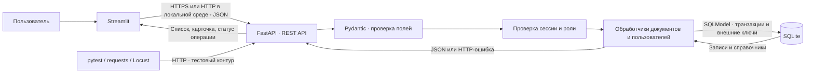

# Лабораторная работа № 8

**Комплексное интеграционное, нагрузочное и безопасностное тестирование информационной системы «Деканат»**

| | |
|---|---|
| Дисциплина | Прикладное программное обеспечение информационных систем |
| Выполнила | Касанова Аружан |
| Группа | ИС-24А |
| Год | 2026 |

## 2. Цель

Проверить совместную работу интерфейса, REST API, авторизации и базы данных проекта DeanFlow. Измерить время ответа при разных уровнях нагрузки, проверить правила доступа и включить автоматические проверки при изменении кода. Работа продолжает [лабораторную № 7](../07/README.md) по тому же проекту.

## 3. Архитектура



| Компонент | Как передаёт данные | Возможные сбои | Интеграционная проверка |
|---|---|---|---|
| Интерфейс Streamlit | Из полей формы формирует JSON, список загружает через `GET` | Сервер недоступен, форма отклонена валидатором | UI → API, ошибка API → сообщение в интерфейсе |
| Сервер FastAPI | Выбирает обработчик, создаёт сессию БД, возвращает HTTP-ответ | Просрочка запроса, исключение при записи | Uvicorn → FastAPI → обработчик |
| База SQLite | Хранит документы, справочники, учётные записи и сессии | Нарушение `UNIQUE`, недопустимый внешний ключ | API → SQLite и отдельная транзакция с откатом |
| Аутентификация | Проверяет пароль по хешу, выдаёт ограниченный по времени Bearer-токен | Неверный пароль, истёкшая сессия | `/auth/login` → токен → защищённый маршрут |
| REST API | Принимает методы GET, POST, PUT и DELETE, возвращает JSON или пустой ответ 204 | Некорректный JSON, отсутствующий идентификатор | Последовательность CRUD, отрицательные случаи |
| Защита | Сверяет роль и выдаёт краткие сообщения, хранит отпечаток токена | Исполнитель пытается удалить документ, пароль попадает в ошибку или журнал | Валидация пароля, граница ролей, маскирование ошибок |

## 4. Инструменты

| Инструмент | Применение |
|---|---|
| Python, FastAPI, Uvicorn | Запуск стенда и обработка HTTP-запросов |
| Streamlit | Интерфейс просмотра и регистрации документов |
| SQLModel, SQLite | Хранение данных и проверка транзакций |
| pytest, requests | Автоматические проверки и фактические ответы REST API |
| Locust, psutil, Matplotlib | Нагрузочные сценарии, измерение ресурсов процесса и графики |
| Bandit, GitHub Actions | Статический анализ и запуск проверок при обновлении кода |

## 5. Интеграционное тестирование REST API

Прогоны выполняются на временной SQLite с синтетическими данными. Изменения, сделанные во время проверки, удаляются вместе с временной базой. `PUT` обновляет полное редактируемое представление, `PATCH` сохраняет поддержку частичного обновления.

| Сценарий | Маршрут | Код | Содержание ответа |
|---|---|---:|---|
| Прочитать список | `GET /documents` | 200 | Массив карточек документов |
| Зарегистрировать документ | `POST /documents` | 201 | Созданная карточка, идентификатор и номер регистрации |
| Обновить документ | `PUT /documents/{id}` | 200 | Карточка с заменёнными полями |
| Удалить документ администратором | `DELETE /documents/{id}` | 204 | Пустое тело |
| Проверить результат удаления | `GET /documents/{id}` | 404 | Сообщение об отсутствии документа |
| Отправить пустой объект | `POST /documents` | 400 | Общая ошибка валидации |
| Отправить синтаксически неверный JSON | `POST /documents` | 400 | Общая ошибка валидации |
| Прочитать отсутствующего пользователя | `GET /auth/users/{id}` с ролью администратора | 404 | Сообщение об отсутствии пользователя |
| Запросить защищённый список без входа | `GET /documents` | 401 | Требуется авторизация, `WWW-Authenticate: Bearer` |

Тела ответов и статусы реального HTTP-прогона сохранены в [api.json](evidence/api.json).

## 6. Тестирование базы данных

Тесты открывают временный файл SQLite через SQLModel и выполняют `INSERT`, `SELECT`, `UPDATE` и `DELETE` с повторным чтением между изменениями. В отдельной транзакции после предварительной успешной вставки добавляется запись с дублирующимся значением поля `UNIQUE`. SQLAlchemy сообщает об `IntegrityError`. После `rollback()` новый сеанс подтверждает, что промежуточная вставка не сохранилась, а существующие записи доступны. Это проверяет атомарность транзакции и сохранение целостности при отказе второй операции.

## 7. Нагрузочное тестирование

Нагрузочные прогоны выполняются на локальном стенде. Результаты и графики появятся в этом разделе по завершении измерений.

## 8. Проверка безопасности

| Проверка | Ожидаемое поведение |
|---|---|
| Регистрация с пустым паролем | 400, запись не создана |
| Слишком короткий пароль или пароль без цифры | 400, запись не создана |
| Вход с неизвестным логином или неправильным паролем | Одинаковое сообщение 401 без подтверждения наличия аккаунта |
| Чтение защищённого документа без токена | 401, данные недоступны |
| Некорректные типы в JSON | 400, введённое значение скрыто в сообщении |
| Удаление документа исполнителем | 403, администратор может выполнить операцию |
| Чужой профиль по токену исполнителя | 403 |
| Повторное обращение после выхода | 401, сессия удалена |
| Ошибки и логи при проверках ввода | Без паролей и токенов |

Пароль хранится в виде PBKDF2-HMAC-SHA256 с индивидуальной солью. Сервер хранит SHA-256 отпечаток случайного токена с ограниченным сроком жизни. Сам пароль и сам токен в БД не сохраняются.

## 9. Автоматические тесты

```bash
python -m pip install -r requirements.txt
python -m pytest -v
```

Набор охватывает штатные операции, границы длины названия документа 3 и 250 знаков, ошибки валидации, ограничения ролей и откат транзакции. Запускать проверки можно из корня репозитория. Код тестов расположен в [tests](../../tests/).

## 10. GitHub Actions

Рабочий процесс запускается при `push` и `pull_request`. Он устанавливает зависимости, выполняет pytest и статический анализ, сохраняет результаты проверок. [Запуски GitHub Actions](https://github.com/kasanovaaruzan74-oss/-/actions).

## 11. Найденные недостатки и исправления

| Наблюдение | Исправление | Повторная проверка |
|---|---|---|
| В исходном демо операции с документами были доступны без входа | Включён профиль `AUTH_REQUIRED=true`, запросы проверяют действующий токен и права роли | Без токена 401, удаление исполнителем 403 |
| Исходный API поддерживал частичное обновление методом `PATCH` | Добавлен `PUT` для полной замены редактируемых полей | Штатное обновление 200, чтение возвращает новые значения |
| Детальные ответы валидатора могли содержать отправленное значение | В профиле ЛР № 8 обработчик возвращает сообщение без содержимого поля | Неправильный JSON и типы дают 400, секреты отсутствуют в сообщениях и журнале |

## 12. Вывод

Контур лабораторной связывает проверки HTTP, SQL-транзакций, прав доступа и производительности. Автоматический запуск позволяет обнаружить регрессии в коде раньше, чем изменения попадут в рабочую версию. Результаты относятся к локальному стенду с синтетическими документами и одним процессом Uvicorn.

## Короткие ответы для защиты

1. **Цель интеграционного теста.** Подтвердить, что компоненты корректно передают данные и обрабатывают общие ошибки.
2. **Unit и Integration.** Unit-тест проверяет отдельную функцию или правило. Интеграционный тест проверяет связку, например API и SQLite.
3. **HTTP-коды.** `200` означает успешную обработку, `201` создание, `204` успешное выполнение без тела, `400` некорректный запрос, `401` необходимость авторизации, `403` отсутствие права, `404` отсутствие ресурса.
4. **Типы нагрузочных проверок.** Обычная нагрузка, стресс выше ожидаемой нагрузки, пик с резким ростом, длительный тест на стабильность.
5. **Response Time и Throughput.** Первое измеряет задержку ответа, обычно в мс. Второе показывает число обработанных запросов за единицу времени.
6. **Целостность SQL.** Ограничения проверяют допустимость данных, `commit` фиксирует целую транзакцию, `rollback` отменяет её промежуточные изменения.
7. **Задачи безопасности.** Ограничить доступ, проверять ввод, скрывать чувствительные данные в ответах и логах, хранить защищённые представления паролей и токенов.
8. **Зачем pytest.** Он собирает тесты, запускает сценарии с независимыми фикстурами и выдаёт подробную ошибку при несовпадении ожидаемого и фактического результата.
9. **Вклад CI.** Каждое изменение запускает одинаковый набор автоматических проверок. История показывает, при каком изменении нарушился контракт.
10. **Ограничения автоматизации.** Тесты обнаруживают известные сценарии и потребуют поддержки при изменении контракта. Удобство интерфейса проверяют отдельно.
11. **Если стенд перестанет справляться.** Проверить медленные запросы, пагинацию и индексы. При конкурирующих записях оценить PostgreSQL и несколько процессов API. Изменения проверять повторным измерением.
12. **Зачем документировать.** Нужны конфигурация стенда, сценарий, фактические числа и код версии, чтобы воспроизвести результат и объяснить отличие двух прогонов.

[Формулировка задания ЛР № 8](https://chatgpt.com/s/t_6af4005ed7f88191a5fabf3cf1cedc50).
