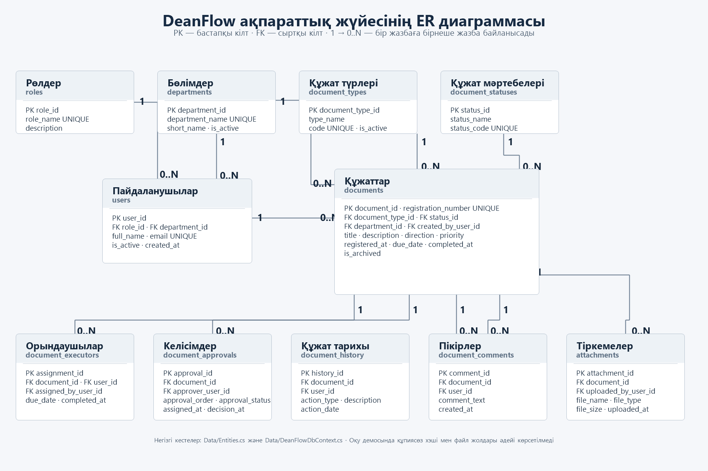

# DeanFlow

**DeanFlow** — университет деканатының құжат айналымын, орындаушыларға берілген тапсырмаларды және келісу кезеңдерін басқаруға арналған ақпараттық жүйе. Жүйеде құжатты тіркеу, іздеу, орындаушы тағайындау, мерзімін бақылау, түсініктеме мен тіркеме қосу және есеп қалыптастыру мүмкіндіктері бар. Қол жеткізу құқықтары пайдаланушының рөліне қарай шектеледі.

Бұл каталогта бастапқы **ASP.NET Core MVC + Entity Framework Core + SQL Server** қосымшасы орналасқан. **FastAPI + SQLModel + Streamlit + SQLite** зертханалық нұсқасын іске қосу тәртібі [репозиторийдің түбіріндегі нұсқаулықта](../README.md) берілген. Зертханалық нұсқа жеке SQLite дерекқорын пайдаланады.

## Деректер қорының ER диаграммасы



[Диаграмманың SVG бастапқы нұсқасы](docs/diagrams/deanflow-er.svg)

Диаграммадағы негізгі байланыстар:

- Бір рөлге бірнеше пайдаланушы тіркеле алады.
- Бір бөлімге бірнеше пайдаланушы және құжат тіркеле алады.
- Бір құжат түрі мен бір мәртебеге бірнеше құжат сәйкес келеді.
- Бір пайдаланушы бірнеше құжатты тіркей алады.
- Бір құжатта бірнеше орындаушы тағайындауы, келісімі, тарих жазбасы, пікірі және тіркемесі болуы мүмкін.
- Әр орындаушы тағайындауы, келісімі және тарих жазбасы тиісті пайдаланушымен байланысады.

Негізгі қосымшаның entity-кластары `Data/Entities.cs` ішінде, ал кестелер мен сыртқы кілттер `Data/DeanFlowDbContext.cs` ішінде анықталған. Зертханалық демо диаграммадағы негізгі құжат, пайдаланушы, бөлім, түр және мәртебе байланыстарын шағын SQLite дерекқорында көрсетеді.

## Қолданылған технологиялар

| Бөлік | Технология |
| --- | --- |
| Негізгі веб-қосымша | ASP.NET Core MVC, Razor, .NET 10 |
| Негізгі деректер қоры | SQL Server, Entity Framework Core |
| Құжаттар мен файлдар | `App_Data/` каталогы, рұқсатты тексеретін контроллерлер |

## Негізгі веб-қосымшаны іске қосу

Қажет: .NET 10 SDK және жергілікті SQL Server. Әдепкі қосылым жолы `localhost\SQLEXPRESS` мекенжайын пайдаланады. Серверіңіз басқа мекенжайда болса, оны Git-ке енгізбей, `User Secrets` арқылы өзгертіңіз:

```powershell
cd original
dotnet user-secrets set "ConnectionStrings:DefaultConnection" "Server=YOUR_SERVER;Database=DeanFlowDB;Trusted_Connection=True;TrustServerCertificate=True;"
dotnet run
```

Қосымша `https://localhost:...` мекенжайында ашылады. Дерекқордың бастапқы схемасын жоба өздігінен өзгертпейді: миграцияны, кесте құруды және бастапқы деректерді енгізуді жауапты әкімші орындайды.

## Зертханалық материалдар

Ағымдағы зертханалық жұмыстар, API, тесттер және қорғау материалдары [репозиторийдің түбірінде](../README.md) қолжетімді. Жобаның алғашқы нұсқасына арналған [қазақша әдістемелік материал](docs/laboratory-guide-kk.md) осы каталогта сақталған.
